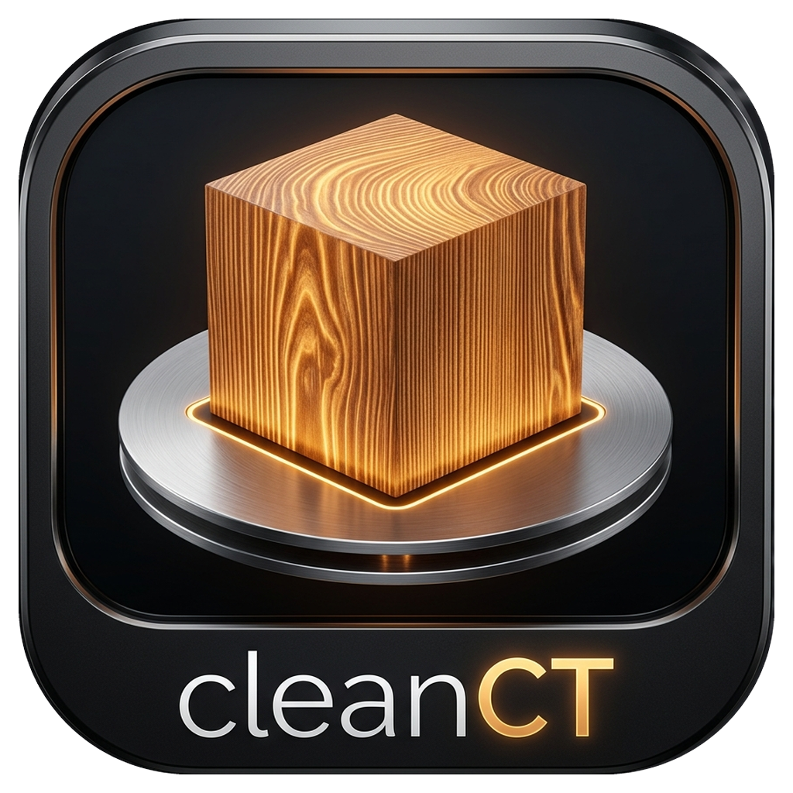

<p align="center">
  
</p>

<h1 align="center">cleanCT</h1>

<p align="center"><b>Non-destructive metal-base removal and inspection of micro-CT wood scans</b></p>

<p align="center">
  <a href="docs/RELEASE_NOTES.md"></a>
  
  
  
  
  <a href="LICENSE"></a>
</p>

<p align="center">
  
</p>

---

## Abstract

cleanCT is a native Windows application (PySide6 / Qt 6) for micro-CT scans of wood specimens mounted on a metal base. It locates the metal base and the wood, shows four guide lines for review, removes the base with a metal-removal engine, and exports the inner wood region as DICOM and NIfTI with a verified bundle. Source scans are never modified.

## Features

- **Scan input.** DICOM series, multipage TIFF stacks and 3-D NIfTI (`.nii`, `.nii.gz`). Scans are registered in place; DICOM folders are linked by junction.
- **Detection.** The metal top (Cut), the wood top (Keep) and the lateral box (L, R) are detected from the scan and placed on editable lines (Auto snap).
- **Review.** The Boundaries tab: drag or type the lines, scrub the sagittal, coronal and axial planes, choose colour maps and density windows. Apply lines reprocesses the scan.
- **Results.** Before and After axial and longitudinal views, a 3-D point cloud, and a marker when the processed run differs from the lines on screen.
- **Inner-ROI export.** The delivered region is the kept slices between Keep and Cut, clipped to the L/R box. The DICOM and NIfTI outputs hold the same voxels.
- **Verified bundles.** A bundle is staged, checked (UIDs, pixel values, geometry) and only then promoted. A failed check writes nothing.
- **Checkpoints.** A preview with its lines and settings can be saved as `.ctcheckpoint.json` and reopened. Applied previews are kept as a history for the session.
- **Compute.** NVIDIA GPU through CuPy (CUDA 12) when available; the validated CPU path otherwise, with the same algorithm.

## Gallery

| Overview and 3-D point cloud | Interactive cut boundaries |
|---|---|
|  |  |
| Results view: axial and longitudinal panels with the delivered region, and the 3-D point cloud (amber wood, silver metal). | Boundaries tab: Keep (wood top), Cut (metal top) and the L/R lateral box, with 2-line and 4-line controls. |
| **Wood micro-CT inspection** | **Portable workstation and export** |
|  |  |
| Metal-first anchor detection on a wood scan; the wood region is preserved and the platform artefact removed. | Settings, export formats (DICOM, NIfTI), checkpoints and the activity log. Runs from a portable folder. |

## Installation

| Package | File | Notes |
|---|---|---|
| Portable | `cleanCT-1.0.0-portable.zip` | Extract the whole folder and run `cleanCT.exe`. No administrator rights needed. |
| Installer | `cleanCT-1.0.0-setup.exe` | Per-machine setup; asks for administrator approval. |

Both files are attached to the GitHub Release, with a SHA-256 sidecar for the ZIP.

**Requirements:** Windows 10 or 11, 64-bit. An NVIDIA GPU with a CUDA 12 driver is optional. Keep free disk space for results and exports; a `.nii.gz` source is expanded to temporary storage at about its uncompressed size.

## Quick start

1. **Load scan…** (Ctrl+O): choose a DICOM folder, a TIFF file or a NIfTI file, enter a specimen ID and select *Load & Register*.
2. **Boundaries:** check the Keep, Cut and L/R lines against the scan.
3. **Process** (Ctrl+R), or **Apply lines** after editing a line, to run the metal-removal pipeline.
4. **Results:** review the delivered region.
5. **Export** (Ctrl+E), or **Process and export**, to write the bundle.

## Output bundle

| File | Content |
|---|---|
| `<ID>_dcm/` | Kept DICOM slices under their original file names, with source tags and delivery metadata. |
| `<ID>.nii` | Kept slices as one NIfTI volume, cropped to the same L/R box as the DICOM. |
| `<ID>.json` | Sidecar: cut and keep slices, L/R box, geometry and file mapping. |
| `<ID>_extraction_info.txt` | Plain-text extraction report. |

TIFF and NIfTI sources are exported as NIfTI only.

## Build from source

The processing engine is the `engine/` folder of this repository. Outputs of a source run go to the engine's default output folder unless `CLEANCT_OUTPUT_ROOT` is set.

```powershell
# environment (pinned packages)
powershell -ExecutionPolicy Bypass -File installer\setup_env.ps1 <path to python.exe>

# run from source
python main.py

# health check (exit 0 = PASS)
python main.py --selfcheck

# regression gate (37 suites)
powershell -NoProfile -ExecutionPolicy Bypass -File tests\run_cleanct_regressions.ps1

# release package (gate, package, launcher, portable ZIP, setup)
python installer\build_installer.py --iscc "<path to ISCC.exe>"
```

The release build needs PyInstaller 6.22.2 and Inno Setup 6.

## Repository structure

| Path | Contents |
|---|---|
| `main.py` | Entry point. |
| `src/` | Application: `core/` (logic), `widgets/`, `dialogs/`, `main_window.py`, `theme.py`. |
| `assets/` | `banner/` (gallery), `screenshots/` (documentation), `icons/` (application icon pack), `design/` (source archive). |
| `engine/` | Processing engine: the six modules the application imports. |
| `installer/` | Build script, launcher source, Inno Setup script, environment setup. |
| `tests/` | Regression suites and test tools. |
| `docs/` | User guide, implementation details, release notes and change records. |
| `version/` | Release folders (not versioned). |
| `PRODUCT.md`, `DESIGN.md` | Design context. |

## Documentation

| Document | Content |
|---|---|
| [`docs/USER_GUIDE.md`](docs/USER_GUIDE.md) | Step-by-step guide. Ships with the application. |
| [`docs/cleanCT_details.md`](docs/cleanCT_details.md) | Implementation details of v1.0.0 (also as `.docx`). |
| [`docs/ROI_LOGIC.md`](docs/ROI_LOGIC.md) | Detection formulas and coordinate systems (earlier design; see the implementation details). |
| [`docs/RELEASE_NOTES.md`](docs/RELEASE_NOTES.md) | Release notes for v1.0.0. |
| [`docs/REVISION_HISTORY.md`](docs/REVISION_HISTORY.md), [`docs/DEV_LOG.md`](docs/DEV_LOG.md), [`docs/AUDIT.md`](docs/AUDIT.md) | Change and audit records. |

## Known limitations

- The processed axial view steps through 16 stored frames, not every slice.
- A running pipeline cannot be stopped.
- The longitudinal Results view reads the source folders; a moved source shows an error.
- Auto-crop trims the processing output only; bundles are cut to the lines on screen.
- Windows only.

## How to cite

If cleanCT contributes to your research, please cite the software (version 1.0.0). The associated article is in preparation; cite it when it is published. GitHub's *Cite this repository* button reads [`CITATION.cff`](CITATION.cff).

APA (7th edition):

> Hartanto, B. R. (2026). *cleanCT* (Version 1.0.0) [Computer software]. https://github.com/benedictusrey/cleanCT

BibTeX:

```bibtex
@software{hartanto2026cleanct,
  author  = {Hartanto, Benedictus Reynaldo},
  title   = {{cleanCT}: Non-destructive metal-base removal and inspection of micro-CT wood scans},
  version = {1.0.0},
  year    = {2026},
  month   = nov,
  url     = {https://github.com/benedictusrey/cleanCT},
  license = {PolyForm Noncommercial 1.0.0}
}
```

## License

Copyright 2026 Benedictus Reynaldo Hartanto. Licensed under the [PolyForm Noncommercial License 1.0.0](LICENSE). Noncommercial use, including research, teaching and personal study, is permitted. Commercial use is not.
